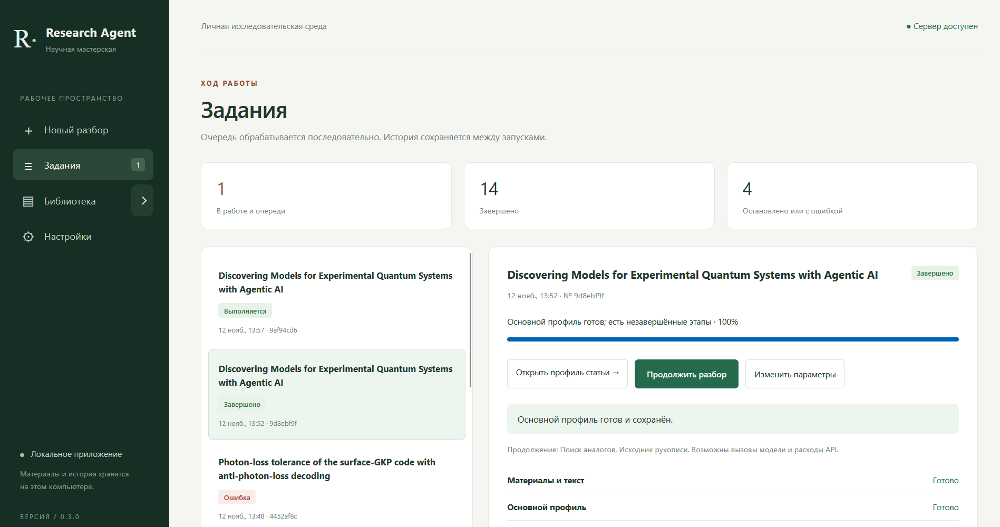

# Research Agent 0.3.0

Локальное приложение для первичного чтения научной статьи. Подготовленный профиль содержит краткий обзор, ключевые слова, утверждения со ссылками на фрагменты статьи и до пяти близких работ. Профиль доступен в браузере и в папке `Materials`.



История версий ведётся в [CHANGELOG.md](CHANGELOG.md).

Интерфейс оформлен в палитре «бумага и кобальт»: тёплый фон, синие действия и сдержанные терракотовые акценты. Навигация находится сверху; состояние разбора показано компактной лентой этапов. Библиотека, профили, настройки и отдельные страницы Markdown, цитат и TeX используют общее оформление, адаптированное к узким экранам. Шрифты поставляются локально; сведения об их источниках и отдельных лицензиях находятся в [static/fonts/README.md](static/fonts/README.md).

## Лицензия

Код можно бесплатно использовать, изменять и распространять в некоммерческих целях с сохранением текста лицензии и уведомлений об авторских правах. Для коммерческого использования требуется отдельное письменное разрешение правообладателя. Полные условия изложены в [LICENSE](LICENSE).

## Запуск на Windows

### ResearchAgent.exe и Docker Desktop

1. Один раз установите [Docker Desktop для Windows](https://docs.docker.com/desktop/setup/install/windows-install/) и завершите его первоначальную настройку. Выберите режим Linux containers.
2. Если Research Agent уже работает через `start.cmd`, остановите этот экземпляр. Оба способа запуска используют одну библиотеку и порт `8765`.
3. Дважды нажмите `ResearchAgent.exe` в папке проекта рядом с `compose.yaml`. Windows-сборка из GitHub Actions содержит готовый Docker-образ с Python, PDFium и остальными библиотеками. Если запускаете из исходников, лаунчер сам скачает базовый образ и соберёт окружение. Первый запуск может занять несколько минут. Когда сервер ответит, значок станет зелёным и откроется браузер.

Правый щелчок по значку открывает команды запуска и остановки сервера, браузер и папку `Materials` в Проводнике. Жёлтая точка означает запуск или остановку, серая — остановленный сервер, красная — ошибку. «Закрыть значок» закрывает меню Windows. Сервер можно остановить отдельной командой.

Docker хранит окружение отдельно от файлов проекта. `Materials` и база в `data` остаются в тех же папках Windows. Для анализа используется существующая переменная `OPENAI_API_KEY`, которую должен видеть лаунчер. Ключ передаётся серверу при запуске и не входит в образ. Браузер открывает `http://127.0.0.1:8765/`.

При сборке из исходников выполните `powershell -NoProfile -ExecutionPolicy Bypass -File .\build-windows.ps1`. Скрипт использует компилятор .NET Framework из Windows и создаёт `ResearchAgent.exe` рядом с `compose.yaml`. В Docker можно также запустить сервер командой `docker compose up -d --build` из папки проекта.

### Прямой запуск через Python

Дважды нажмите `start.cmd`. Откроется окно сервера и браузер с адресом http://127.0.0.1:8765. Оставьте окно сервера открытым. Для остановки нажмите в нём Ctrl+C.

Требуются Python 3.10 или новее и пакеты из `requirements.txt`. Скрипт сначала ищет обычный Python, затем использует доступный на этом компьютере Python из локального runtime Codex. Сам Codex запускать не требуется. Скрипт покажет команду установки, если выбранному Python не хватает зависимостей.

Для ручного запуска из папки проекта выполните:

```powershell
python -m pip install -r requirements.txt
python app.py
# Отдельный экземпляр с отдельной базой и папкой Materials
python app.py --port 8766 --data-dir ./data-other
```

Вариант без открытия браузера: `powershell -NoProfile -ExecutionPolicy Bypass -File .\start.ps1 -NoBrowser`.

Для настоящего профиля с обзором сервер использует `OPENAI_API_KEY` из окружения. Если переменная была добавлена после запуска приложения, перезапустите сервер из процесса, который уже видит переменную. В «Настройках» можно обновить список моделей по ключу, выбрать модель и поддерживаемое усилие анализа. По умолчанию выбрана `gpt-6-luna` с усилием `low`. Модель должна быть доступна вашему API-проекту и поддерживать [структурированный вывод Responses API](https://developers.openai.com/api/docs/guides/structured-outputs?api-mode=responses).

На Linux приложение запускается теми же командами через `python3`; рекомендуется отдельное окружение `.venv`. Скрипты `start.cmd` и `start.ps1` предназначены для Windows.

## Подготовка профиля

Режим «Полный текст + картинки» отправляет в OpenAI PDF основной статьи с изображениями страниц. В «Анализе иллюстраций» каждый распознанный рисунок сопровождается описанием, связью с текстом и выводом. Явно выделенные дополнительные материалы исключаются во всех режимах. Исходный PDF хранится целиком. Завершённые задания можно удалить из истории с сохранением профиля и PDF.

Галочка «Проверить библиографию моделью» в новом разборе добавляет один вызов для распарсованного списка литературы. Приложение проверяет предложенные исправления по исходному тексту или метаданным и показывает ссылку на полный текст, когда её подтверждает источник. В режиме с картинками этот вызов входит в общий бюджет шести попыток.

1. В «Новом разборе» вставьте ID или ссылку arXiv либо загрузите PDF. В текстовых режимах размер PDF ограничен 15 МБ. Для arXiv приложение запрашивает последнюю версию, даже если ссылка содержит старый номер, и скачивает PDF с точным номером найденной версии. Загруженный PDF сохраняется целиком.
2. При необходимости задайте фокус обзора и охват текста: 16 000, 30 000 (по умолчанию), 48 000 символов или «Передавать полный текст». Для отдельных ответов пишите по одному вопросу со знаком «?» на строку или пронумеруйте их. Прямо в форме выберите модель и усилие для этой статьи: начальные значения берутся из общих настроек, изменения остаются только в задании. Нажмите «Подготовить профиль». Статус, этапы, остановка и данные об использовании API доступны в «Заданиях».
3. Откройте статью из «Библиотеки» или из списка по стрелке рядом с ней. В основной библиотеке под названием видны авторы и раскрывается оригинальная аннотация, если она есть в источнике. «Открыть профиль» показывает оформленный Markdown в новой вкладке. В интерактивном профиле можно раскрыть ответы, словарь и пояснения к утверждениям. Под записью в библиографии раскройте «Места цитирования», чтобы увидеть найденные упоминания. Ссылка открывает нужную страницу в штатном PDF-просмотрщике браузера. При точном сопоставлении текста сервер добавляет выделение в копию PDF.
4. Для arXiv нажмите «Обновить с arXiv». Если сохранённая версия актуальна, модель не вызывается, а приложение пробует добавить исходник, если он ещё отсутствует. При успешной обработке новой версии PDF и профиль заменяются в той же папке. Если обновление не удалось, прежний профиль остаётся доступен с указанием его версии.
5. «Повторить поиск аналогов» использует сохранённые PDF и обзор. Сравнение кандидатов занимает до одного вызова модели. Состояние источников и результаты отбора видны в разделе «Как искали аналоги».
6. «Продолжить разбор» в задании или профиле выполняет недостающие этапы новым связанным заданием. До запуска показаны этапы и возможность вызовов модели. Через «Изменить параметры» можно изменить ограничения, модель и усилие. При ошибке ключа или квоты сначала исправьте доступ к API. Для PDF без текстового слоя приложение объясняет необходимость другого файла; повтор с тем же материалом недоступен.
7. «Разобрать заново» использует сохранённый PDF. В форме можно изменить вопросы, охват, модель, усилие и ограничения, используя предыдущие или текущие общие настройки. Общие настройки этим действием не меняются. При неудаче прежний профиль остаётся доступен.
8. «Уточнить библиографию» ищет отсутствующие названия и ссылки в сохранённом материале и метаданных. Модель формирует запросы по авторам, журналу, тому, страницам и году; название из текста принимается только с дословным подтверждением. Работа проверяется через DOI, arXiv или Crossref. Это отдельное задание с возможным одним вызовом модели; при её недоступности остаётся поиск метаданных. Обзор статьи заново не создаётся. Найденные записи сохраняются постепенно, а оставшиеся можно уточнить повторно.

Формулы TeX отображаются в интерактивном профиле и в HTML-просмотре сохранённого Markdown. Запись `$...$` используется внутри строки, а `$$...$$` — для отдельной формулы. В словаре, ключевых словах и темах формулы показываются внутри строки. Преобразование в MathML выполняет [локальный KaTeX](static/vendor/katex/README.md).

Сохранён и режим «Демонстрация» для проверки очереди без внешних запросов. Задания работают при закрытой вкладке, пока открыт сервер. После перезапуска незавершённые задания помечаются как прерванные и не повторяются автоматически.

## Охват текста и источники ответов

Текст делится по страницам и разделам на фрагменты до 2000 символов, предпочтительно по границам абзацев или предложений. Соседние фрагменты перекрываются не более чем на 200 символов. Библиография и благодарности обрабатываются отдельно. Если все фрагменты помещаются в выбранный бюджет, они передаются целиком одним запросом. В режиме «Передавать полный текст» выборка по числу символов отключается. Если запрос превышает допустимый размер, приложение просит выбрать меньший охват. В бюджет входят аннотация arXiv (до 4000 символов) и перекрытия; инструкции и метаданные считаются отдельно.

Для длинной статьи после включения аннотации половина оставшегося бюджета резервируется под общий охват разделов, половина — под вопросы и фокус. Фрагменты по вопросам ранжируются локально методом BM25 с небольшим набором русско-английских соответствий научных терминов. Свободный бюджет перераспределяется; одинаковые фрагменты не повторяются. Без вопросов весь бюджет используется для общего охвата. Поиск по словам может пропустить смысловые соответствия, особенно между разными языками. Это выборка, а не гарантия чтения всей статьи.

В разделе «Что прочитано» отдельно показаны извлечённые страницы, объём фрагментов и страницы, переданные модели. Символы выборки и доступного текста считаются с учётом перекрытий. Охват текста и усилие рассуждения модели — разные настройки.

Для уточнения названий первый запрос дополнительно получает до 12 библиографических записей без названия и короткий контекст их цитирования. Эти данные учитываются отдельно от бюджета основных фрагментов и также отображаются в «Что прочитано». Отдельное задание уточнения библиографии передаёт модели до 40 записей за один вызов; поиск метаданных проходит по всем оставшимся записям в пределах времени задания.

Ответы содержат проверенные ссылки на переданные фрагменты и страницы PDF. Приложение проверяет наличие цитаты в источнике, но не доказывает логическое следование ответа из цитаты. Неподтверждённые ответы и ответы старых профилей без источников помечаются явно.

## Модели и стоимость

Список доступа запрашивается сервером через `GET /v1/models`; ключ не передаётся браузеру. Основное меню объединяет список с каталогом моделей, для которых известны поддержка структурированного вывода и допустимые усилия. Другие идентификаторы можно ввести вручную с усилием по умолчанию; их совместимость и цена могут быть неизвестны. Получение списка не проверяет возможность конкретного запроса анализа и не запускает пробную генерацию.

Цены поставляются в `model_catalog.py` как датированный справочник [публичных тарифов OpenAI](https://developers.openai.com/api/docs/pricing), актуализируемый вместе с приложением. Кнопка обновления запрашивает доступные модели, а не новые цены. Тарифы относятся к Standard и короткому контексту. Расчёт в задании использует сохранённый снимок тарифа и сообщённые токены с учётом кешированного входа. При неполных данных стоимость неизвестна. Это оценка, не счёт поставщика. Подписка ChatGPT и баланс по обычному проектному ключу не определяются; в интерфейсе есть ссылка на биллинг.

## Обработка и границы результата

- Номер версии определяется через [API arXiv](https://info.arxiv.org/help/api/user-manual.html), с резервной проверкой официальной страницы статьи. Если точный номер установить не удалось, загрузка останавливается.
- Из PDF извлекается текст с номерами страниц. Для текстовых режимов пределы составляют 200 страниц, 60 000 символов на страницу и 1 500 000 символов всего. В режиме с картинками эти пределы сняты. Текстовые режимы требуют текстового слоя или OCR. Материалы сохраняются до вызова модели и доступны для продолжения при ошибке.
- Основной профиль публикуется до поиска аналогов, сетевого уточнения библиографии и получения исходника. Дополнительные этапы имеют резерв времени на сохранение. Их ошибки не удаляют готовый обзор. При продолжении успешные этапы используются повторно. Полной истории редакций профиля пока нет: устаревшая ссылка на файл предлагает открыть актуальный профиль.
- Библиография извлекается локально из PDF с привязкой к страницам. Разорванные переносами слова склеиваются с учётом написания в статье; смысловые дефисы и дефисы в DOI/URL сохраняются. Название, авторы и данные публикации отображаются отдельными строками, год ставится в конце в скобках. Если название отсутствует, оно ищется в тексте и метаданных, а до установления показывается «Название не установлено». Поиск отсутствующих названий проходит по всем записям в пределах времени задания. Ссылки выбираются по доступному PDF, идентификатору arXiv, подтверждённой странице издателя или DOI.
- Для arXiv приложение запрашивает архив исходников той же версии. При однозначном выборе основного файла TeX его можно открыть с подсветкой и скачать из новой вкладки. Если исходник представлен Word, он сохраняется как `manuscript.docx`. Для PDF без доступного исходника открываются PDF и профиль.
- Аналоги подбираются по библиографии и тематическим запросам в arXiv и [Crossref](https://www.crossref.org/documentation/retrieve-metadata/rest-api/). Сравниваются только кандидаты с читаемым полным PDF на arXiv или по прямой ссылке из метаданных. Модель получает фрагменты основной части, прежде всего методы и результаты. При пустом повторном поиске сохраняются прежние аналоги с подтверждением из полного текста.
- Фрагменты текста и вопросы для анализа передаются в OpenAI. Поисковые фразы передаются arXiv и Crossref, отдельные библиографические записи отправляются Crossref для поиска метаданных. Ключ остаётся в окружении серверного процесса. Запросы к OpenAI могут расходовать средства API.
- В обычном разборе по умолчанию до двух вызовов модели и 240 секунд на задание. Текстовый запрос ограничен 500 000 байтами JSON и 200 секундами в пределах оставшегося времени.
- «Полный текст + картинки» допускает до шести попыток и минимум 600 секунд на задание. Время можно увеличить до 3600 секунд. Для основного анализа действуют ограничения выбранной модели и API на файлы, контекст и выход. Если материал требуется разделить, готовые части сохраняются для продолжения. В интерфейсе отображаются попытки и токены, сообщённые API.
- При ограничении запросов Crossref приложение сохраняет уже извлечённую библиографию и ждёт окончания паузы перед новыми обращениями к Crossref. Недостающие записи можно уточнить повторно из профиля.
- Профиль фиксирует результаты чтения статьи и вопросы к ней. Проверка формул, воспроизведение экспериментов и оценка новизны относятся к будущей рецензии.

## Хранение

```text
Materials/
  Первый автор — Название статьи [arxiv-2409.10975]/
    article.pdf
    text.txt
    document.json
    profile.json
    profile.md
    manuscript.tex
```

`profile.json` — источник данных для страницы и Markdown. Для arXiv папка соответствует ID без версии. `manuscript.tex` или `manuscript.docx` появляется при наличии доступного исходника. Идентичные загруженные PDF объединяются по SHA-256. При обновлении старых профилей локальный текст используется для восстановления библиографии, мест нумерованных цитат и отсутствующей аннотации, когда её удаётся выделить. При указании отдельного `--data-dir` его папка `Materials` находится внутри этого каталога.

`document.json` кеширует текст страниц, метаданные и ссылки, связывая их с SHA-256 PDF и версиями обработчика, pypdf и PDFium. При повторном разборе или уточнении библиографии устаревший кеш перестраивается из локального PDF. Каждое сохранение профиля получает отдельный `revision` для согласованности интерфейса и файлов.

В `data/research.sqlite3` находятся настройки, индекс материалов и история, в `data/uploads/` — копии исходных загрузок, в `data/checkpoints/<job_id>/` — PDF и данные этапа для продолжения. После полного завершения временные файлы задания и его непосредственного предшественника удаляются; незавершённые этапы сохраняют свои данные. `data` и `Materials` исключены из Git. Для резервной копии остановите сервер и скопируйте обе папки.

Сервер предназначен для личного использования и слушает `127.0.0.1`. Приложение работает на Python и SQLite, интерфейс использует HTML, CSS и JavaScript.

## Проверки

```powershell
python -m unittest discover -s tests -v
```

Тесты используют временные папки и локальные порты, реальное извлечение PDF и подменённые ответы arXiv, Crossref и OpenAI. Проверяются таймаут после сохранения обзора, продолжение, кеш, повторный разбор, цитаты, цены и восстановление после перезапуска. GitHub Actions настроен на Windows/Linux и Python 3.10/3.13.

Браузерные сценарии (также без расходов API):

```text
python -m pip install -r requirements-dev.txt
python -m playwright install chromium
python tests/browser_smoke.py
```

Сценарии проверяют создание и повтор разбора, меню и клавиатурную навигацию, раскрывающиеся разделы, локальные шрифты и все основные страницы на ширине 1440, 768, 390 и 320 пикселей. Отдельно проверяются просмотр профиля, цитаты и исходника TeX. Для установленного Edge можно указать `--channel msedge`, для сохранения скриншотов — `--screenshots .test-data/design-review`.

Отдельная ручная проверка реальных ответов требует ключа и расходует API; по умолчанию не запускается:

```text
python tests/live_check.py --live path/to/paper-one.pdf path/to/paper-two.pdf
```
